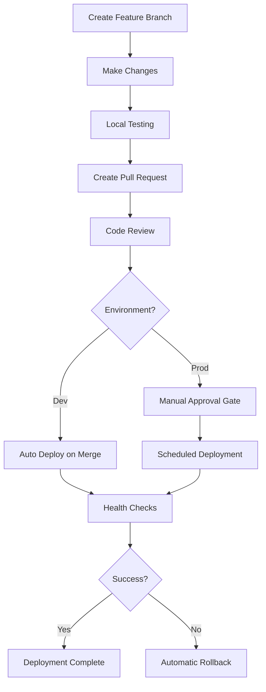

# Deployment Procedures

## Overview

This document provides detailed procedures for deploying infrastructure changes using the Terraform CI/CD pipeline. It covers both development and production deployment workflows, approval processes, and best practices.

## Prerequisites

Before deploying any infrastructure changes:

1. **AWS Access**: Ensure you have appropriate AWS permissions
2. **GitHub Access**: Repository write access and ability to create pull requests
3. **Environment Setup**: Local development environment configured
4. **Understanding**: Familiarity with Terraform and the project structure

## Development Environment Deployment

### Quick Development Deployment

Development deployments are designed for rapid iteration and testing.

**Process**:
1. Create feature branch from `develop`
2. Make infrastructure changes
3. Create pull request to `develop` branch
4. Automated deployment on merge

**Steps**:

```bash
# 1. Create and switch to feature branch
git checkout develop
git pull origin develop
git checkout -b feature/add-new-service

# 2. Make your infrastructure changes
# Edit files in environments/dev/ or modules/

# 3. Test locally (optional but recommended)
cd environments/dev
terraform init
terraform plan

# 4. Commit and push changes
git add .
git commit -m "Add new service configuration"
git push origin feature/add-new-service

# 5. Create pull request via GitHub UI
# Target: develop branch
# Reviewers: At least 1 team member
```

**Automated Process**:
- Pull request triggers validation and planning
- Merge to `develop` triggers automatic deployment
- No manual approval required for dev environment
- Deployment typically completes in 5-10 minutes

### Development Deployment Checklist

- [ ] Changes tested locally with `terraform plan`
- [ ] No sensitive data in code (use variables/secrets)
- [ ] Proper resource naming with `dev` environment prefix
- [ ] Cost-optimized resource sizes for development
- [ ] Pull request has descriptive title and description
- [ ] At least one code review approval

## Production Environment Deployment

### Production Deployment Process

Production deployments require careful planning and manual approval.

**Process**:
1. Create feature branch from `main`
2. Make infrastructure changes
3. Create pull request to `main` branch
4. Code review and approval (minimum 2 reviewers)
5. Manual approval gate for deployment
6. Scheduled deployment during maintenance window

**Steps**:

```bash
# 1. Create production feature branch
git checkout main
git pull origin main
git checkout -b feature/prod-new-service

# 2. Make infrastructure changes
# Edit files in environments/prod/ or modules/

# 3. Test changes thoroughly
cd environments/prod
terraform init
terraform plan  # Review plan carefully

# 4. Create comprehensive pull request
git add .
git commit -m "feat: Add new service to production

- Add ECS service configuration
- Update load balancer target groups  
- Add CloudWatch monitoring
- Update security groups

Tested in dev environment successfully.
Expected impact: New service deployment, no downtime expected."

git push origin feature/prod-new-service
```

**Pull Request Requirements**:
- **Title**: Clear, descriptive title with impact summary
- **Description**: Detailed explanation of changes
- **Testing**: Evidence of testing in dev environment
- **Impact Assessment**: Expected impact on production
- **Rollback Plan**: How to rollback if issues occur
- **Reviewers**: Minimum 2 approvers (including 1 senior team member)

### Production Approval Process

**GitHub Environment Protection**:
- Manual approval required from infrastructure team
- Deployment restricted to maintenance windows
- Required status checks must pass

**Approval Checklist**:
- [ ] Code review completed by 2+ team members
- [ ] Changes tested in development environment
- [ ] Impact assessment documented
- [ ] Rollback plan identified
- [ ] Maintenance window scheduled (if required)
- [ ] Stakeholders notified
- [ ] Monitoring and alerting updated

**Maintenance Windows**:
- **Standard**: Tuesdays and Thursdays, 2-4 AM EST
- **Emergency**: Any time with proper justification
- **Major Changes**: Scheduled during planned maintenance

## Deployment Workflows

### Standard Workflow



### Emergency Deployment

For critical production fixes:

```bash
# 1. Create hotfix branch
git checkout main
git checkout -b hotfix/critical-security-fix

# 2. Make minimal necessary changes
# Focus only on the critical issue

# 3. Fast-track review process
# Notify team in Slack #infrastructure-alerts
# Request expedited review

# 4. Deploy with emergency approval
# Use emergency approval process
# Monitor deployment closely
```

**Emergency Criteria**:
- Security vulnerabilities
- Service outages
- Data loss prevention
- Compliance violations

## Deployment Monitoring

### Real-time Monitoring

During deployments, monitor:

**Application Health**:
```bash
# Health endpoint monitoring
watch -n 5 'curl -s https://your-app.example.com/health | jq .'

# ECS service status
aws ecs describe-services --cluster myapp-prod --services myapp-prod-service
```

**Infrastructure Metrics**:
- CloudWatch dashboards
- Application performance metrics
- Error rates and response times
- Resource utilization

**Logs Monitoring**:
```bash
# Application logs
aws logs tail /aws/ecs/myapp-prod --follow

# Infrastructure logs
aws logs tail /aws/lambda/myapp-prod-function --follow
```

### Post-Deployment Validation

**Automated Checks**:
- Health endpoint responses
- Database connectivity
- External service integration
- Performance benchmarks

**Manual Validation**:
- User acceptance testing
- Feature functionality verification
- Performance validation
- Security scan results

## Deployment Strategies

### Blue-Green Deployment

For zero-downtime deployments:

```bash
# 1. Deploy to green environment
cd environments/prod-green
terraform apply

# 2. Test green environment
./scripts/health-check.sh prod-green

# 3. Switch traffic
aws route53 change-resource-record-sets \
  --hosted-zone-id Z123456789 \
  --change-batch file://switch-to-green.json

# 4. Monitor and validate
# Keep blue environment for quick rollback
```

### Rolling Deployment

For ECS services:

```hcl
# In Terraform configuration
resource "aws_ecs_service" "app" {
  deployment_configuration {
    maximum_percent         = 200
    minimum_healthy_percent = 50
  }
  
  deployment_circuit_breaker {
    enable   = true
    rollback = true
  }
}
```

### Canary Deployment

For gradual rollouts:

```bash
# 1. Deploy canary version (10% traffic)
terraform apply -var="canary_weight=10"

# 2. Monitor metrics for 30 minutes
# Check error rates, response times

# 3. Gradually increase traffic
terraform apply -var="canary_weight=50"
terraform apply -var="canary_weight=100"
```

## Troubleshooting Deployments

### Common Issues

**State Lock Issues**:
```bash
# Check lock status
terraform force-unlock <lock-id>

# Or wait for automatic timeout (20 minutes)
```

**Resource Conflicts**:
```bash
# Import existing resources
terraform import aws_instance.web i-1234567890abcdef0

# Remove phantom resources
terraform state rm aws_instance.phantom
```

**Permission Issues**:
```bash
# Verify AWS credentials
aws sts get-caller-identity

# Check IAM permissions
aws iam simulate-principal-policy \
  --policy-source-arn arn:aws:iam::123456789012:role/terraform-role \
  --action-names ec2:RunInstances \
  --resource-arns "*"
```

### Deployment Failures

**Immediate Actions**:
1. **Stop deployment** if still in progress
2. **Assess impact** on production services
3. **Notify team** via Slack #infrastructure-alerts
4. **Decide on rollback** vs. forward fix

**Investigation Steps**:
```bash
# Check Terraform output
terraform show

# Review AWS CloudTrail
aws logs filter-log-events \
  --log-group-name CloudTrail/ManagementEvents \
  --start-time $(date -d '1 hour ago' +%s)000

# Check resource status
aws ec2 describe-instances --instance-ids i-1234567890abcdef0
```

## Best Practices

### Code Quality

- **Formatting**: Always run `terraform fmt` before committing
- **Validation**: Use `terraform validate` to check syntax
- **Linting**: Use tools like `tflint` for additional validation
- **Documentation**: Comment complex configurations

### Security

- **Secrets Management**: Never commit secrets to Git
- **Least Privilege**: Use minimal required permissions
- **Encryption**: Enable encryption for all data at rest
- **Network Security**: Use security groups and NACLs appropriately

### Cost Optimization

- **Resource Sizing**: Right-size resources for actual usage
- **Auto Scaling**: Implement auto-scaling where appropriate
- **Scheduled Shutdown**: Use auto-shutdown for dev resources
- **Cost Monitoring**: Set up billing alerts and budgets

### Reliability

- **Multi-AZ**: Deploy across multiple availability zones
- **Health Checks**: Implement comprehensive health checks
- **Monitoring**: Set up proactive monitoring and alerting
- **Backup Strategy**: Regular backups and tested recovery procedures

## Deployment Checklist

### Pre-Deployment

- [ ] Changes tested in development environment
- [ ] Code reviewed and approved
- [ ] Impact assessment completed
- [ ] Rollback plan identified
- [ ] Monitoring and alerting configured
- [ ] Stakeholders notified (if required)
- [ ] Maintenance window scheduled (if required)

### During Deployment

- [ ] Monitor deployment progress
- [ ] Watch for errors or warnings
- [ ] Verify health checks pass
- [ ] Check application functionality
- [ ] Monitor performance metrics
- [ ] Be ready to rollback if needed

### Post-Deployment

- [ ] Verify all services operational
- [ ] Run comprehensive health checks
- [ ] Validate new functionality
- [ ] Update documentation
- [ ] Notify stakeholders of completion
- [ ] Schedule post-deployment review

## Support and Escalation

### Getting Help

- **Slack**: #infrastructure-team for general questions
- **Slack**: #infrastructure-alerts for urgent issues
- **Email**: devops-team@company.com
- **PagerDuty**: Infrastructure team escalation

### Escalation Process

1. **Level 1**: Team member assistance
2. **Level 2**: Senior infrastructure engineer
3. **Level 3**: Infrastructure team lead
4. **Level 4**: CTO and management team

---

**Document Version**: 1.0  
**Last Updated**: January 18, 2026  
**Next Review**: April 18, 2026  
**Owner**: DevOps Team